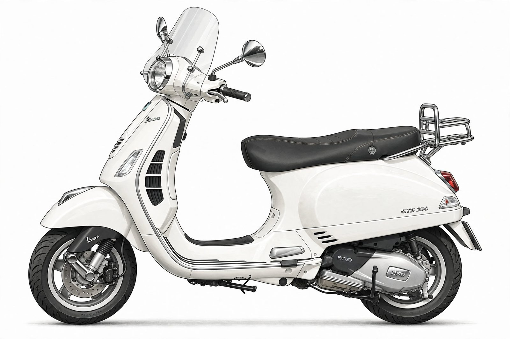

<p align="center">
  
</p>

<h3 align="center">An AI field mechanic for the machines we keep.</h3>

<p align="center">
  <a href="https://cerebralvalley.ai/e/meta-ai-developer-hackathon"></a>
  <a href="https://nextjs.org"></a>
  <a href="https://dev.meta.ai/docs/models"></a>
  
</p>

<p align="center">
  <a href="#the-loop">The loop</a> ·
  <a href="DIARY.md">Build diary</a> ·
  <a href="#credits">Credits</a>
</p>

Point your camera at your Vespa and it identifies the component, outlines it on your photo, talks you through the repair hands-free, and files the work on your scooter's passport. Underneath sits a twelve-model archive — every story, spec, and procedure the mechanic reasons over.

Built for the Meta AI Developer Hackathon, Oct 27 – Nov 4 2026. Every commit here is hackathon work. Demo video lands before the deadline.

## Quickstart

```bash
npm install
npm run dev        # http://localhost:3000
```

AI features need a Meta Model API key (hackathon credits cover this many times over):

```bash
cp .env.example .env.local   # paste your key — never commit this file
```

The key lives server-side only (`app/api/*`); the browser never sees it.

## The loop

| Step | What happens | Status |
| ---- | ------------ | ------ |
| See it | Photo → component + model + condition, with confidence and manual confirm | landing |
| Outline it | SAM 3.1 mask drawn over your photo — tap the part, not a menu | landing |
| Hear it | Voice-guided repair steps, hands-free "next step" | landing |
| Fix it | Manual-grounded procedures with torque + safety notes | live (illustrative) |
| Keep it | Service record filed to your scooter's passport in the garage | live |

## What's real, what's illustrative

Everything here is labeled like a museum. The archive — twelve model records, specs, timelines, the 3D viewer, the garage — is real and runs today. Fitment data and repair procedures are illustrative patterns compiled from public catalogue shapes: always confirm part numbers and torque values against the workshop manual for your exact variant. AI features stay marked `landing` until they ship; nothing here fakes a model call.

## Inside the repo

```
app/         routes — archive, timeline, models, inspect, repairs, garage, clubs
components/  3D viewer, field guide, steppers, garage, clubs directory
lib/         archive data, faults, fitment, service schedules, glossary
design/      brand tokens, Blender pipeline, repair scope, renders
public/      studio plates, documentary photos, 3D models (all credited)
```

## The archive

Twelve records, 1946–2018: Vespa 98, 125, GS 150, 50, SS180, Rally 200, Primavera, PX, T5, ET4, GTS, 946, Elettrica. Studio illustration plates, credited documentary photographs, an Inside-the-Vespa systems guide, fault finder, glossary, and club directory.

## Credits

- AI: Muse Spark, SAM 3.1, Muse Voice via the Meta Model API; one feature on Muse Spark Open
- 3D: Vespa Primavera ET3 by Nadia Ribitis, CC-BY-4.0 (Sketchfab)
- Photos: Wikimedia Commons contributors, credited per image (`public/frieze/CREDITS.txt`)
- Built with Muse Code. Fan-made tribute — not affiliated with Piaggio or Meta.

## License

Landing before submission (MIT intended). Commons photos and the ET3 model keep their own licenses.
